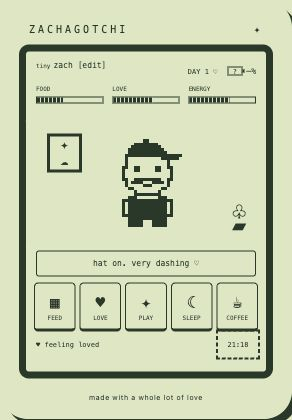
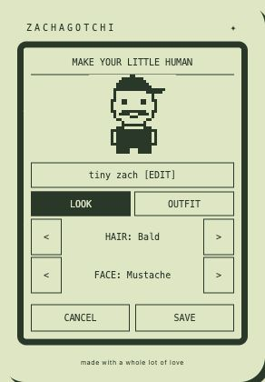
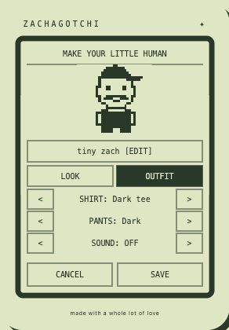
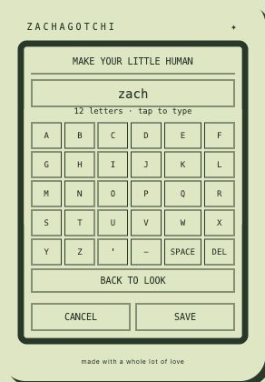

# Zachagotchi

I was making a life counter from [Didget's Library](https://www.patreon.com/cw/DidgetsLibrary), and the parts and size made my girlfriend think of a Tamagotchi. So, naturally, I made **Zachagotchi**: a tiny pixel version of myself. I thought it would be a fun project to share so other people could build on it and make a little version of themselves for someone they love.

A customizable, monochrome pocket human for the **Freenove FNK0104B ESP32-S3 2.8-inch 240×320 touch display**. Feed him, give him coffee, put on his ball cap, and send a little love. Everything fits vertically on one touchscreen—no scrolling, phone app, or coding needed to play.

> **First public preview: v0.3.0.** The original game has run successfully on the board. Newer customization, audio, hat, and coffee features still need a full hardware test. The Windows installer is new; see [verification status](docs/RELEASING.md#verification-status). Install only on the matching board.
>
> **Flashing erases everything on the board**, including its current program, Wi-Fi settings, and any existing Zachagotchi progress. No backup is made. Ordinary power-off is different: the game saves progress during play.

## See it in action

These are screenshots of the working **browser preview**, not photographs of the hardware. The firmware uses matching pixel artwork and touch controls; its text rendering differs slightly. The preview's battery shows `—%` because a browser cannot read the board's battery voltage.

| Care buttons & ball cap | Hair & facial hair |
| :---: | :---: |
|  |  |
| **Shirts, pants & sound** | **Custom name** |
|  |  |

## What can your tiny human do?

| Touch control | What it does |
| --- | --- |
| **FEED** | Give a snack; food goes up. |
| **LOVE**, or tap his body | Give affection and little heart effects. |
| **PLAY** | Spend a little energy for more love. |
| **SLEEP / WAKE** | Start or end a nap. Energy recovers while napping. |
| **COFFEE** | Give a tiny coffee for an energy boost. |
| Tap the top of his head | Put the ball cap on or take it off. |
| Tap the name / **[edit]** | Change name, hair, facial hair, shirt, pants, or sound. |
| Hold the name for 3 seconds | Open Wi-Fi/clock setup on the board. |
| Tap the clock | Turn the display off immediately. |
| Double-tap a sleeping display | Wake the display without accidentally pressing a care button. |

- **Make it yours:** 6 hairstyles, 5 facial-hair styles, 4 shirts, 4 pants, a classic fixed-size head, and a name up to 12 characters. Save or cancel your edits; no reflash needed.
- **Gentle care:** age counts upward, but there is no death, punishment, or forced restart. This is love, not homework.
- **Retro sound:** short synthesized effects through the optional speaker. Mute in **OUTFIT**. No audio files or memory card required.
- **Saved progress:** alternating, checked on-board saves after actions and before display sleep. A power cut during a write may lose that in-flight action; the previous completed save is the fallback.
- **Screen sleep:** backlight turns off after one idle minute. This is display sleep, not deep sleep; time and needs continue while powered.
- **Clock recovery:** after total power loss, clock sync over Wi-Fi restores real-world time and reconciles offline progress. Without sync, saved progress is retained, but the device cannot know how long it was unplugged.
- **Battery indicator:** top-right icon/percentage estimated from voltage—not a precision fuel gauge. Charging affects the estimate; unknown readings show `--%`.

## Parts list

These are the parts links from my build. Listings can change: **check specifications, connector polarity, dimensions, and the case's hardware requirements before ordering.** The case-specific fastener/magnet sizes and quantities are not specified here; use the case designer's instructions rather than guessing from a multipack listing.

| Part | Link | Needed? / notes |
| --- | --- | --- |
| Screen / controller board | [Freenove ESP32-S3 2.8-inch touch display](https://www.amazon.com/dp/B0FSQF6FKN/) | **Required: FNK0104B**, capacitive touch, 240×320, 16 MB flash / 8 MB PSRAM. Check the actual board marking: FNK0104A is the non-touch version and is not supported. Other “CYD” boards are not interchangeable. [Freenove model reference](https://github.com/Freenove/Freenove_ESP32_S3_Display#fnk0104b28-inch-ili9341-touch). |
| USB-C **data** cable | Use a suitable cable you already own | Required for flashing and USB power. A charge-only cable will not work. |
| Battery | [3.7 V 3000 mAh LiPo, listed 1.25 mm plug](https://www.amazon.com/dp/B0FR8XSXX6/) | Optional for portable use. Confirm the cell matches Freenove's battery requirements and the connector **and polarity** match the board. A plug fitting is not proof of compatibility. |
| Memory card | [2-pack 8 GB TF/microSD cards with adapters](https://www.amazon.com/dp/B0GYHX86XQ/) | **Not used by current firmware.** Optional for future experiments; saves use internal flash. |
| Speaker | [Alrhso 1 W, 8 Ω mini speakers, listed 1.25 mm 2-pin plug](https://www.amazon.com/dp/B0GX6GZFJ2/) | Optional for sound; connect to the board's speaker socket, not GPIO pins. Check the actual plug and board requirements. |
| Screws | [Screw assortment](https://www.amazon.com/dp/B0DJQGY98G/) | Case-dependent; choose the thread and length specified by the case. |
| Heat-set inserts | [Heat-set insert assortment](https://www.amazon.com/dp/B0CN2HDXN6/) | Case-dependent; match the screw thread and printed insert pockets. |
| Magnets | [Magnets](https://www.amazon.com/dp/B0FMP58G7B/) | Case-dependent; confirm diameter, thickness, and quantity with the case design. |
| Printed case | [Didget's Library](https://www.patreon.com/cw/DidgetsLibrary) | The current case is from Didget's Library. **Case files are not included or covered by this project's license.** Obtain them from the creator under their terms. I'll update this when I have my own case designed. |

Disconnect USB and the battery before assembling or connecting parts. Follow the board/cell manufacturer's instructions; do not use damaged cells or force/reverse a battery connection. Keep loose magnets and small parts away from children and pets. Test the board over USB before fitting everything into a case.

## Install — no programming tools needed

A Mac or Windows computer flashes the firmware **onto the board**; the game then runs on the board, not on your computer. You do not copy the DMG to a memory card.

### 1. Download

Open this repository's **Releases → v0.3.0 → Assets** (not the green **Code → Download ZIP** button). Choose:

| Computer | Download |
| --- | --- |
| Apple Silicon or Intel Mac | `Zachagotchi-Flasher-0.3.0.dmg` |
| Windows 10/11 **x64** | `Zachagotchi-Flasher-0.3.0-Windows-x64.zip` |

The Mac package includes native tools for both Mac architectures: **no Rosetta, Python, Homebrew, or Arduino required**. The Windows ZIP is a portable, double-click terminal installer with bundled esptool; no Python or administrator rights needed. Windows ARM64 and 32-bit Windows are not supported by this package. Both installers work offline once downloaded.

### 2. Plug in the board

1. Check **FNK0104B** is printed on the actual board.
2. Plug its USB-C upload port into your computer with a **data-capable USB cable**.
3. Close Arduino Serial Monitor, other flashing tools, and any app using that serial port.

### 3. Run the installer

**macOS**

1. Open the DMG. Double-click **Zachagotchi Flasher.app**, or the `.command` alternative alongside it. Terminal opens; there is nothing to drag to Applications.
2. The build is unsigned/not notarized. If macOS blocks it, follow [Apple's guidance for opening a trusted app](https://support.apple.com/en-us/102445) using **System Settings → Privacy & Security → Open Anyway**, if available. Do not disable Gatekeeper globally. A managed Mac may require its administrator's approval.
3. Select the board's `/dev/cu.usbmodem…` port by number.

**Windows**

1. Right-click the downloaded ZIP → **Extract All**. Keep the whole extracted folder together; don't run from inside the ZIP.
2. Open the extracted folder and double-click **Zachagotchi Flasher.cmd**. A terminal window opens using Windows PowerShell. Do **not** choose Run as administrator.
3. Select the board's `COM…` port by number. If several are listed, unplug/reconnect the board to identify which one appears, then press `r` to rescan.
4. The launcher allows its local script to run only for that process; it doesn't change your system's PowerShell policy. Follow your organization's policies if a managed PC blocks it. Do not disable antivirus or SmartScreen to force an unfamiliar download to run.

**Then, on either computer:**

1. Read the warning. Type **`INSTALL`** exactly to confirm the destructive clean install, or press Return/Enter to cancel.
2. Keep USB connected until the installer says **installed and verified**. It checks the ESP32-S3 and 16 MB flash before erasing, then writes and verifies the firmware. The model printed on the board still needs your visual check; chip detection cannot identify the screen wiring.
3. The board should restart. If its screen stays black, press and release **RESET/RST once with BOOT untouched**.
4. On Mac, close the installer Terminal window before ejecting the DMG.

### 4. First start

1. The board offers Wi-Fi setup. On a phone or computer, join **Zachagotchi-XXXX** using the password shown on the board.
2. Open **http://192.168.4.1** and enter your **2.4 GHz** Wi-Fi name, password, and time zone. Credentials stay on the board. Wi-Fi is used for clock sync, then turned off between syncs; no account or cloud service is needed.
3. Or tap **SKIP FOR NOW** to play offline; the clock shows `--:--` until synchronized.
4. Tap the name to customize your human. Tap **SAVE**, then start caring for them.

### Trouble connecting?

- **“No serial data received” / connecting dots:** keep USB connected, **hold BOOT → press and release RESET/RST → release BOOT**. Restart the installer and reselect the port; its name may change in bootloader mode.
- **No port:** try another USB data cable/USB port and avoid a hub. On Windows, check Device Manager. Use only a driver supplied by the board/chip manufacturer if the device genuinely requires one; this installer does not add drivers.
- **Port busy:** close serial monitors and any previous installer window.
- **Wrong flash size/model:** stop. Don't force an install on a different board.
- **Failure after erasing starts:** the previous program may be gone. Leave USB connected and retry with BOOT/RESET. Don't interpret a partial write as a successful installation.
- **Screen off later:** double-tap it. Idle screen sleep is normal.

## Updates

For now, **each firmware release gets a new Mac installer and Windows ZIP**. Download the latest Assets and run the same steps. There is no automatic/over-the-air updater and no need to reflash just to change a name or outfit.

**Current installers are clean installers, not save-preserving updaters. Updating resets the character's age, care, appearance, and Wi-Fi settings.** Neither installer reads a backup. This is deliberate and shown before installation.

A future save-preserving update mode would need to leave NVS untouched, check the existing partition/save versions, migrate older records safely, and pass power-cut/recovery tests before it can be promised. See [release and update policy](docs/RELEASING.md).

For the first public push, only **v0.3.0** packages are prepared in `release/`; earlier local installer versions have been removed. Installers are ignored by Git and belong in **GitHub Release Assets**, not source history. Keep source tags/changelogs for future versions; users normally download the release marked **Latest**.

## Build on it

The original Zachagotchi code, artwork, sounds, and documentation are **MIT licensed**. Third-party components retain their own licenses; the external case is not included. See [LICENSE](LICENSE), [third-party notices](installer/THIRD-PARTY.txt), and [source/dependency notes](docs/THIRD_PARTY.md).

**Browser preview** (Node.js 22+):

```sh
npm run dev
# Open http://localhost:5173
npm test
```

No npm dependencies are required. Browser saves are local to that browser and separate from on-board saves; clearing site data clears preview progress. Preview sound starts after a user interaction. The preview cannot verify physical touch, audio, battery, or USB flashing.

**Firmware and installers** (current firmware build tooling requires macOS, Node.js 22+, working Python 3, and internet for setup):

```sh
npm run setup:firmware
npm run fetch:tools
npm run build:firmware
npm run build:dmg
npm run build:windows
npm run build:source
npm run build:third-party
npm run check:release
```

Build dependencies are pinned and installed locally under ignored `.build/`; `ZACH_PYTHON` can select your Python executable. Python is needed to **build**, not to **run** an installer. See [firmware details](firmware/README.md), [contributing](CONTRIBUTING.md), and [publishing checklist](docs/RELEASING.md). Windows users can run the preview/tests and build the ZIP from prebuilt firmware; an all-Windows firmware toolchain is not currently scripted.

| Where | What to change |
| --- | --- |
| `dist/avatar.js` | Shared 32×32 pixel artwork and appearance options |
| `dist/sound.js` | Original synthesized sound effects |
| `dist/game.js` / `firmware/Zachagotchi/care.h` | Matching care rules |
| `firmware/Zachagotchi/main.cpp` | Board rendering, touch, saving, and clock |
| `scripts/build-avatar.cjs` | Generates the compact firmware art/sound tables |
| `installer/` | Mac and Windows terminal flashers |
| `tests/` | Care, persistence, rendering, and installer safety tests |

Ideas, bug reports, new hairstyles, and case designs are welcome. Please don't upload private Wi-Fi credentials, personal save files, or another creator's paid case files.

## Credits

- **My girlfriend**, for seeing a tiny virtual pet in a life-counter build.
- **[Didget's Library](https://www.patreon.com/cw/DidgetsLibrary)**, for the life-counter project that sparked this and the current case design. This repository does not redistribute their case or software.
- **Freenove, Espressif, Arduino, and Adafruit**, for hardware references and the libraries/tools credited in the third-party notices.

An independent hobby project, not affiliated with or endorsed by Tamagotchi/Bandai, Freenove, or Didget's Library. No original Tamagotchi artwork, firmware, or sounds are included.
